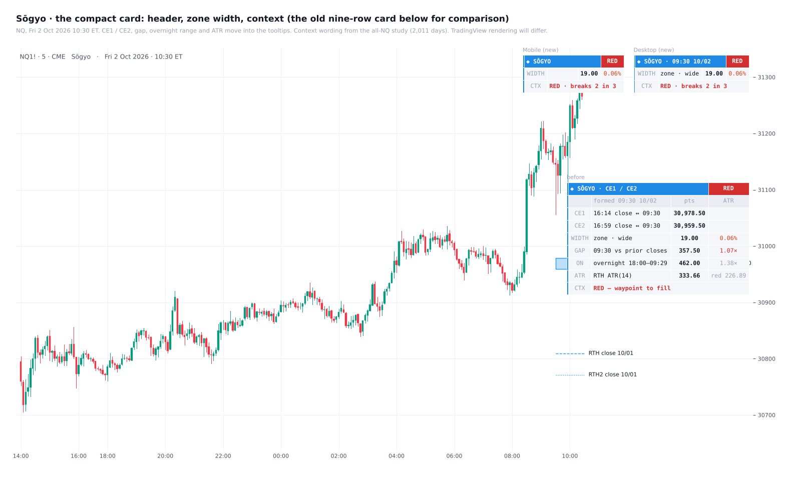

# Sōgyo

**The RTH gap twin midpoints (CE1 / CE2 zone) with a graded card**

TradingView indicator, Pine Script v6. Open source under the Mozilla Public License 2.0.

*Mock-up of how it looks on the chart.*

**Sōgyo** (双魚) is Model 13: the RTH gap's twin midpoints.

## What it draws

At 09:30 ET:
- **CE1** = (prior 16:14 close + 09:30 open) ÷ 2;
- **CE2** = (prior 16:59 close + 09:30 open) ÷ 2.

The zone between them is drawn and carried right.

## The card

Three rows: the header with the context, the zone's width, and the context read. CE1 / CE2, the gap, the overnight range and the ATR sit in the tooltips. Every cell has one.

The context comes from the gap and the overnight range against the RTH ATR. NQ 1-minute, every day from 2018 to 9 Oct 2026 (2,011 days):

| Context | Rule | What it means |
|---|---|---|
| **GREEN · fill 74%** | overnight ≤ 0.45 ATR | A quiet open. The zone was reached on 87% of these days and the full gap filled on 74% (neutral days: 81% / 64%). As a wall it held 60% overall, but 50% in 2019–21, the years the rule was not fitted on. |
| **RED · breaks 2 in 3** | gap > 0.68 ATR | At the first NY AM touch the zone broke toward the fill 67% of the time, under 50% held in every period. Only 24% of these days filled. |
| **NEUTRAL · coin flip** | neither | The zone held 50% at the first touch. |
| **SPLIT · skip** | open between the two closes | CE1 and CE2 straddle the open; both were touched on 91% of these days. |

The full study is in `research/Model_13C_Sogyo_All_NQ.md`. It covers:
- the zone as a target by time of day and gap size: reached 78%, filled 60%, the same in every period;
- the context rule tested on 2019–21, never seen before;
- the "flipped wall", which did not hold up.

The RTH ATR is read from 15-minute bars, so it works on a 1-minute chart and in Bar Replay.

## Settings

**View** sits at the top:
- theme;
- layout (Desktop / Mobile; Mobile drops the wording beside the width);
- card text;
- label text, label colour and date format.

The card can sit in any of eight places and has its own accent colour.

## Credits

- Concepts: ICT (Michael J. Huddleston), consequent encroachment of the RTH gap.
- Written from scratch.

## Add it to TradingView

1. In TradingView, open the **Pine Editor** (bottom panel).
2. Copy the contents of `Sogyo.pine` into a new script.
3. **Save**, then **Add to chart**.

## License

Mozilla Public License 2.0, see [LICENSE](LICENSE). © Unclehk2000.

*Historical frequencies, not guarantees. Nothing here is financial advice.*
