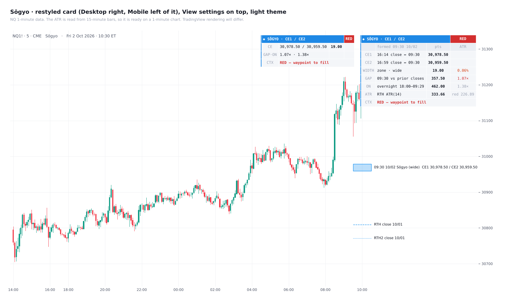

# Sōgyo

**The RTH gap twin midpoints (CE1 / CE2 zone) with a graded card**

TradingView indicator, Pine Script v6. Open source under the Mozilla Public License 2.0.

*Mock-up of how it looks on the chart.*

**Sōgyo** (双魚) is Model 13: the RTH gap's twin midpoints.

## What it draws

At 09:30 ET:
- **CE1** = (prior 16:14 close + 09:30 open) ÷ 2;
- **CE2** = (prior 16:59 close + 09:30 open) ÷ 2.

The zone between them is drawn and carried right.

## The card

The card reads the gap and the overnight range against the RTH ATR, and grades the zone:
- **GREEN:** valid confluence;
- **RED:** a waypoint to the fill;
- **SPLIT:** the open sits between the two closes, so skip;
- **NEUTRAL:** don't weight it.

**Rows:**
- CE1;
- CE2;
- zone width;
- gap and overnight range in ATR;
- the ATR, with the red threshold.

Every cell has a tooltip. The RTH ATR is read from 15-minute bars, so it works on a 1-minute chart and in Bar Replay.

## Settings

**View** sits at the top:
- theme;
- layout (Desktop / Mobile, a four-row card for a phone);
- card text;
- label text, label colour and date format.

The card can sit in any of eight places and has its own accent colour.

## Credits

- Concepts: ICT (Michael J. Huddleston), consequent encroachment of the RTH gap.
- Written from scratch.

## Add it to TradingView

1. In TradingView, open the **Pine Editor** (bottom panel).
2. Copy the contents of `Sogyo.pine` into a new script.
3. **Save**, then **Add to chart**.

## License

Mozilla Public License 2.0, see [LICENSE](LICENSE). © Unclehk2000.

*Historical frequencies, not guarantees. Nothing here is financial advice.*
